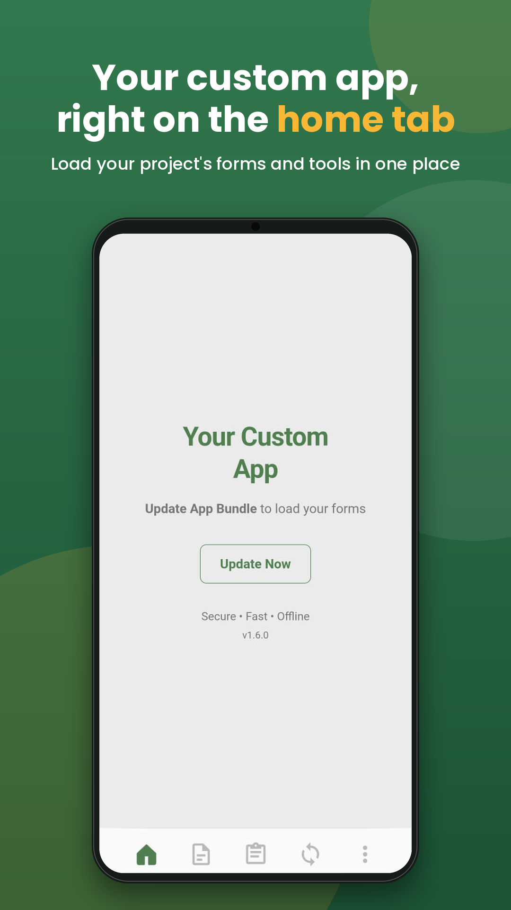
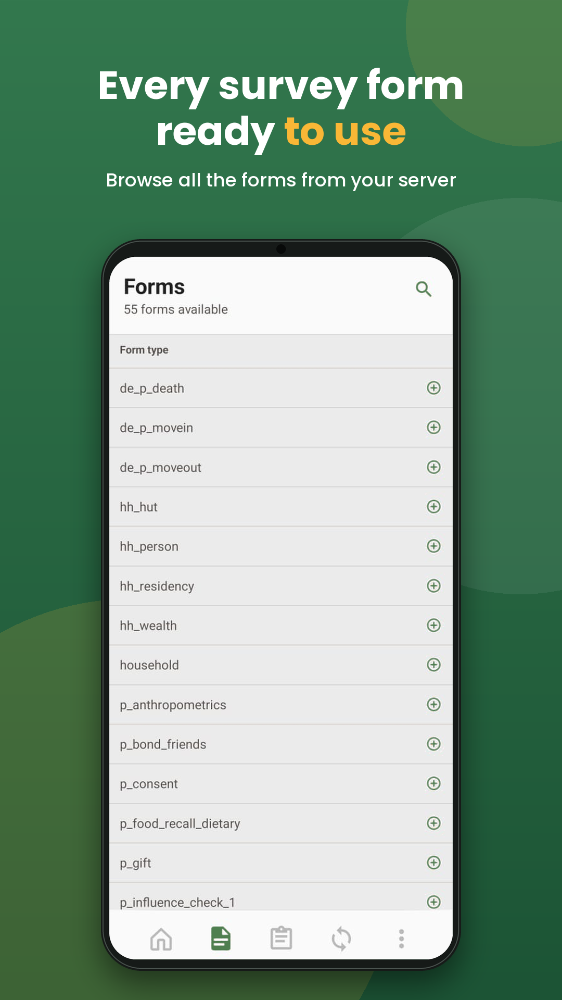
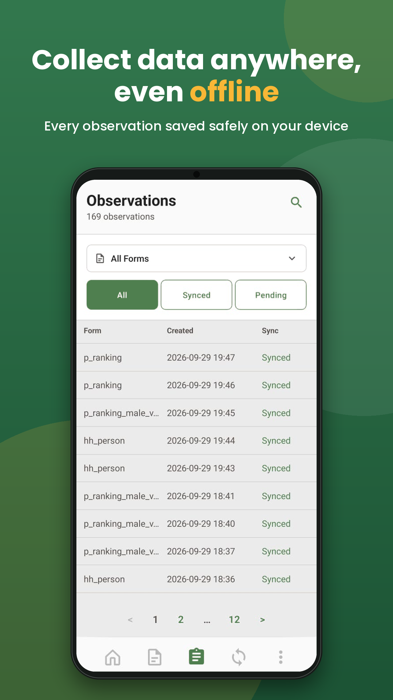
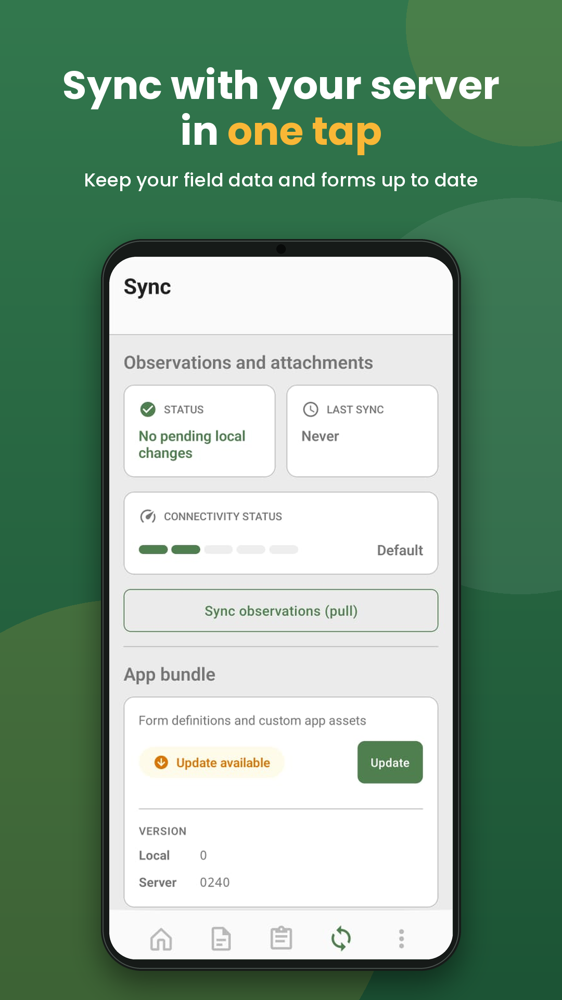
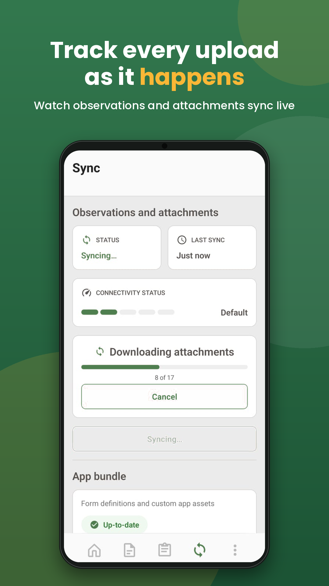
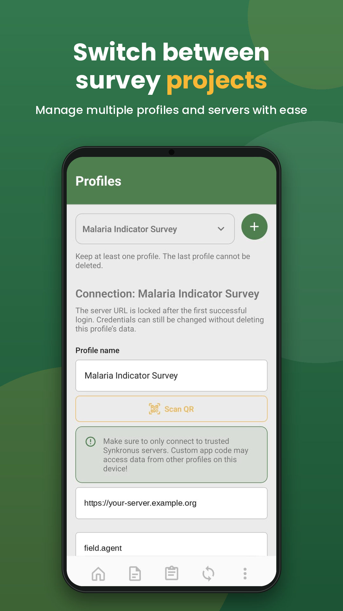
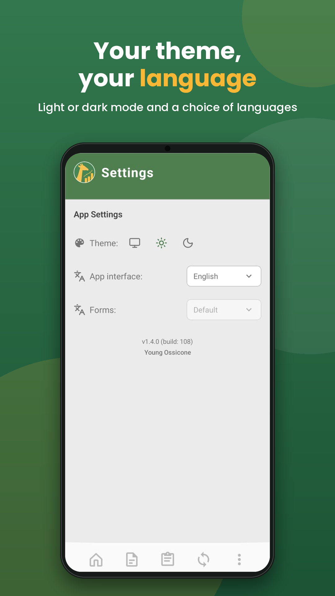
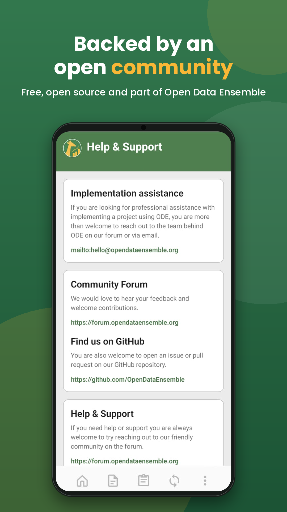

# Open Data Ensemble (ODE)

<!-- Build & CI status -->
[](https://github.com/OpenDataEnsemble/ode/actions/workflows/ci.yml)
[](https://github.com/OpenDataEnsemble/ode/actions/workflows/synkronus-docker.yml)
[](https://github.com/OpenDataEnsemble/ode/actions/workflows/synkronus-cli.yml)
[](https://github.com/OpenDataEnsemble/ode/actions/workflows/formulus-android.yml)
[](https://github.com/OpenDataEnsemble/ode/actions/workflows/ode-desktop.yml)
[](https://github.com/OpenDataEnsemble/ode/actions/workflows/e2e-attachments.yml)
[](https://github.com/OpenDataEnsemble/ode/actions/workflows/docs.yml)

<!-- Release & distribution -->
[](https://github.com/OpenDataEnsemble/ode/releases)
[](https://github.com/OpenDataEnsemble/ode/pkgs/container/synkronus)
<!-- F-Droid badge: enable once Formulus is published to F-Droid -->
<!-- [](https://f-droid.org/packages/org.opendataensemble.formulus) -->

<!-- Project meta -->
[](./LICENSE)
[](#contributing)

**Open Data Ensemble (ODE)** is an open-source platform for mobile data collection and synchronization.

## About ODE

This monorepo contains all the core components of ODE, the members of our *ensemble*. Together they provide an offline-first solution for field data collection that works across mobile devices, the desktop and the web.

## Formulus at a Glance

Formulus is the mobile app that field teams use to collect data. It works fully offline, syncs with your Synkronus server when a connection is available, and can hold several projects on one device.

<p align="center">
  
  
  
  
</p>
<p align="center">
  
  
  
  
</p>

Formulus is available on [F-Droid](https://f-droid.org/packages/org.opendataensemble.formulus/), the [App Store](https://apps.apple.com/app/formulus/id6798318215) and [Google Play](https://play.google.com/store/apps/details?id=org.opendataensemble.formulus), and as an APK from [GitHub Releases](https://github.com/OpenDataEnsemble/ode/releases/latest).

## Architecture

This repository houses the core components plus the public documentation site:

### **formulus**
A React Native project containing the Android and iOS apps. Formulus is the mobile data collection client, designed for field work and offline-first data gathering.

### **formulus-formplayer**
A React web application responsible for rendering JSON forms and communicating with the Formulus mobile app. It provides the form interface used during data collection, including built-in controls such as **`format: sub-observation`** (embedded child rows). Author-facing documentation: [Custom extensions](https://opendataensemble.org/docs/guides/custom-extensions) on opendataensemble.org.

### **synkronus**
The server component, written in Go. It handles authentication, data synchronization and storage for the whole platform.

### **synkronus-cli**
A command-line utility to interact with the Synkronus server. Use it to manage custom app data, handle user administration, export data to Parquet format, and perform other administrative tasks.

Install the CLI with one of these commands:

#### PowerShell
```powershell
irm https://raw.githubusercontent.com/OpenDataEnsemble/ode/main/scripts/install-synkronus-cli.ps1 | iex
```

#### macOS / Linux
```sh
curl -fsSL https://raw.githubusercontent.com/OpenDataEnsemble/ode/main/scripts/install-synkronus-cli.sh | bash
```

**License note:** this component is currently **GPL-2.0-or-later** (see [synkronus-cli/LICENSE](synkronus-cli/LICENSE)) while the QR PNG stack depends on GPL-classified libraries. We plan to swap in a stdlib-only renderer and return the CLI to **MIT**. See [THIRD_PARTY_NOTICES.md](THIRD_PARTY_NOTICES.md).

### **synkronus-portal**
A web-based admin interface for Synkronus. It covers the same tasks as **synkronus-cli** in the browser.

### **desktop**
ODE Desktop, a Tauri app for managing collected data and for building and testing forms and custom apps.

### **docs**
The public documentation site (Docusaurus), published at [opendataensemble.org](https://opendataensemble.org/). It is an independent npm project inside this monorepo. See [docs/README.md](docs/README.md).

## A Young and Welcoming Project

ODE is a young open-source project, and we welcome contributors of all experience levels and interests, including:

- **Software Development** (React Native, React, Go, TypeScript)
- **Documentation** (helping others understand and use ODE)
- **Implementation** (deploying, testing, real-world usage)
- **Community Building** (fostering collaboration and growth)
- **UI/UX Design** (making data collection easier to use)
- **Data Science** (improving data workflows and analytics)

## Contributing

For the full contribution workflow (setup, commit rules, and PR checks), read [CONTRIBUTING.md](CONTRIBUTING.md).

Different perspectives and skills make the project stronger. If you are new to open source, or think your skills are not "technical enough", there is still a place for you here.

**Getting started:**
- Browse the [issues](https://github.com/OpenDataEnsemble/ode/issues) to find something that interests you
- Join the [discussions](https://github.com/OpenDataEnsemble/ode/discussions) to share ideas
- Improve documentation where you see gaps
- Test the platform and report your experience
- Share how you're using ODE in your work

## CI/CD Pipeline

This monorepo uses GitHub Actions for CI/CD. For details (trigger conditions, tags, and workflows), see [.github/CICD.md](.github/CICD.md).

- Synkronus Docker build & publish: `.github/workflows/synkronus-docker.yml`
- Formulus Android build (includes Formplayer asset build): `.github/workflows/formulus-android.yml`
- Documentation site: `.github/workflows/docs.yml` (validates PRs; deploys from `dev`)
- Synkronus deployment docs: `synkronus/DOCKER.md`, `synkronus/DEPLOYMENT.md`

## Code Quality: Linting & Formatting

ODE enforces consistent formatting and linting for the frontend projects both **locally** and in **CI**.

### Formulus (React Native)

- **Run linting**: `cd formulus && pnpm run lint`
- **Run linting with auto-fix**: `cd formulus && pnpm run lint:fix`
- **Format code**: `cd formulus && pnpm run format`
- **Check formatting (no writes)**: `cd formulus && pnpm run format:check`

### Formulus Formplayer (React Web)

- **Run linting**: `cd formulus-formplayer && pnpm run lint`
- **Run linting with auto-fix**: `cd formulus-formplayer && pnpm run lint:fix`
- **Format code**: `cd formulus-formplayer && pnpm run format`
- **Check formatting (no writes)**: `cd formulus-formplayer && pnpm run format:check`

### What CI Enforces

In the main CI workflow:

- For `formulus`:
  - Runs `pnpm run lint` after install and before tests.
- For `formulus-formplayer`:
  - Runs `pnpm run lint`, `pnpm run format:check`, then tests and build.

CI will **fail** if:

- ESLint finds errors, or
- Prettier formatting checks fail (unformatted files).

## License

The repository root is [MIT](./LICENSE). **synkronus-cli** is **GPL-2.0-or-later** until the QR dependency cleanup above is done. Third-party and mixed-component details: [THIRD_PARTY_NOTICES.md](./THIRD_PARTY_NOTICES.md).

## Get Involved

Questions, ideas or feedback are welcome:

- Community forum: [forum.opendataensemble.org](https://forum.opendataensemble.org)
- GitHub: [issues](https://github.com/OpenDataEnsemble/ode/issues) and [discussions](https://github.com/OpenDataEnsemble/ode/discussions)
- Email: [hello@opendataensemble.org](mailto:hello@opendataensemble.org)
